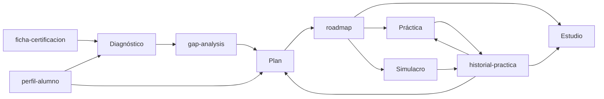

# Estudia tu certificación con IA

Un sistema abierto para preparar **cualquier certificación de ciberseguridad** con IA: diagnóstico inicial, plan adaptado a tu tiempo real, estudio guiado, práctica con pistas y simulacros de examen.

Nació del vídeo de Kasiu Tech **"Así usé la IA para aprobar el CISSP"**, pero no está atado al CISSP. Rellenas una ficha y sirve para Security+, CySA+, AZ-500, CCSP o la que tengas delante.

> La IA no estudia por ti. Te quita horas mal aprovechadas. Las buenas las sigues poniendo tú.

---

## Qué puedes hacer con esto

Una vez montado (lo explico en [Puesta en marcha](#puesta-en-marcha)), hablas con Claude dentro del proyecto con frases normales. Estos son los casos de uso:

| Quieres… | Escribe algo como… | Lo que pasa |
|---|---|---|
| Saber de dónde partes | "Quiero empezar con el diagnóstico" | Test de unas 40 preguntas. En cada una dices si estabas seguro, dudabas o adivinaste. Sale tu **gap analysis**. |
| Tener un plan realista | "Hazme el plan de estudio" | Roadmap semana a semana con tus horas reales, semanas de colchón y simulacros de control. |
| Saber qué hacer hoy | "¿Qué toca hoy?" | Te propone la sesión del día según el plan y tus puntos débiles. |
| Entender un concepto | "Explícame Bell-LaPadula" | Te lo explica sencillo, técnico (conectado con tu experiencia) y como lo pregunta el examen. |
| Revisar lo que has leído | "Revisa mis apuntes del capítulo 3" + tus notas | Te dice qué falta frente al temario, lo resume y te hace cinco preguntas clave. |
| Memorizar algo | "Una mnemotecnia para las fases de respuesta a incidentes" | Dos opciones para que elijas, comprobadas contra el temario. |
| Dejar de confundir conceptos | "Siempre confundo due care con due diligence" | Una analogía de tu mundo y una pregunta trampa para comprobarlo. |
| Practicar con ayuda | "Quiero practicar el dominio 3" | Preguntas con **pistas** si las pides. Se adapta a tus fallos durante la sesión y al final actualiza tu **historial**. |
| Pensar como el examen | "Entréname la mentalidad del examen" | Preguntas donde varias respuestas valen y tienes que elegir la más correcta. |
| Medirte de verdad | "Simulacro de 60 minutos de los dominios 4 y 5" | Condiciones de examen: sin pistas, con el ritmo del examen real. Al final, nota por dominio y corrección. |
| Ajustar el plan | "Reajusta el plan" | Lee tu historial, te hace cuatro preguntas rápidas y te devuelve el roadmap actualizado. |

### Tu rutina

1. **El primer día:** diagnóstico → guarda el `gap-analysis` en el proyecto → pide el plan → guarda el `roadmap`.
2. **Cada día:** "¿qué toca hoy?". Estudia, practica o haz un simulacro según lo que te diga.
3. **Después de practicar o de un simulacro:** sustituye el `historial-practica` del proyecto por la versión nueva que te da.
4. **Cada semana:** "reajusta el plan" y sustituye el `roadmap` por la versión nueva.

> Lo que no está en los documentos del proyecto, un chat nuevo no lo sabe. Cuando una skill te da un documento actualizado, sustitúyelo en el proyecto y todo lo demás funciona solo.

---

## Las cinco skills

| Skill | Para qué | Genera |
|---|---|---|
| `cert-diagnostico` | Test inicial con tu nivel de seguridad en cada respuesta | `gap-analysis` |
| `cert-planificacion` | Crear el plan, reajustarlo y decirte qué toca hoy | `roadmap` |
| `cert-estudio` | Tres niveles, revisión de apuntes, resúmenes, mnemotecnias y analogías | — |
| `cert-practica` | Práctica guiada con pistas graduales, adaptación a tus fallos y mentalidad del examen | `historial-practica` |
| `cert-simulacro` | Examen cronometrado, completo, por dominios o por temas, sin ayudas | `historial-practica` |

**Práctica o simulacro.** La práctica es para aprender: hay pistas, explicaciones al momento y la sesión se adapta a ti. El simulacro es para medirte: sin ayudas, con tiempo y con la corrección al final.

---

## Cómo encaja todo

Hay cinco documentos en el proyecto. Dos los rellenas tú y tres los generan las skills.

| Documento | Quién lo hace | Quién lo usa |
|---|---|---|
| `ficha-certificacion` | Tú, con el temario oficial | Todas las skills |
| `perfil-alumno` | Tú | Diagnóstico, plan y estudio |
| `gap-analysis` | `cert-diagnostico` | Plan, estudio y práctica |
| `roadmap` | `cert-planificacion` | Plan, práctica y simulacro |
| `historial-practica` | `cert-practica` y `cert-simulacro` | Plan, estudio, práctica y simulacro |



---

## Puesta en marcha

Pensado para Claude (proyectos + skills). La idea funciona igual en herramientas con proyectos o asistentes personalizados.

### 1. Rellena tus dos documentos

1. Descarga el **temario oficial** (exam outline) de tu certificación desde la web del certificador.
2. Rellena `plantillas/ficha-certificacion.md` con ese temario. Para el CISSP tienes un ejemplo en `ejemplos/cissp/`.
3. Rellena `plantillas/perfil-alumno.md` con **tu tiempo real**, no con el que te gustaría tener.

### 2. Crea el proyecto

1. En Claude, crea un proyecto con el nombre de tu certificación.
2. Pega en las instrucciones el contenido de `proyecto/instrucciones-proyecto.md`, o la versión sin skills si estás en el plan gratuito.
3. Sube a los documentos del proyecto el temario oficial, tu ficha y tu perfil.

### 3. Añade las skills (planes de pago)

1. Descarga el repositorio (botón **Code → Download ZIP**) y descomprímelo.
2. Dentro de `skills/` hay cinco carpetas. Comprime cada una en su propio `.zip` (en Windows: clic derecho → Comprimir en archivo ZIP). Cada `.zip` debe contener la carpeta con su `SKILL.md` dentro.
3. Súbelos uno a uno desde la sección de skills de la configuración de Claude.

Las skills personalizadas necesitan un plan de pago y la ejecución de código activada. Los menús cambian a menudo; si no los encuentras, busca "skills" en el centro de ayuda de Claude.

### 4. Arranca

Abre un chat en el proyecto y escribe:

> Quiero empezar con el diagnóstico.

---

## Qué hay en este repositorio

```
├── proyecto/
│   ├── instrucciones-proyecto.md             ← con skills (planes de pago)
│   └── instrucciones-proyecto-sin-skills.md  ← plan gratuito
├── plantillas/                               ← lo único que rellenas tú
│   ├── ficha-certificacion.md
│   └── perfil-alumno.md
├── skills/                                   ← una skill por capacidad
│   ├── cert-diagnostico/
│   ├── cert-planificacion/
│   ├── cert-estudio/
│   ├── cert-practica/
│   └── cert-simulacro/
└── ejemplos/
    └── cissp/ficha-certificacion.md          ← ficha rellena de ejemplo
```

---

## Lo que esto NO hace

- **No sustituye al material oficial.** La IA se equivoca, a veces con mucha seguridad. La fuente de verdad es el temario y el material del certificador.
- **No reproduce preguntas reales del examen.** Casi todos los certificadores te hacen firmar un acuerdo de confidencialidad. Usar volcados te puede costar la certificación. Esto entrena el razonamiento, no la memoria de unas preguntas.
- **Las preguntas generadas son orientativas.** Combínalas con los tests oficiales de práctica.
- **No controla el tiempo por ti.** En el simulacro, Claude calcula el ritmo, pero el reloj lo llevas tú.
- **No promete aprobar en dos semanas.** Si alguien te lo vende, desconfía.

---

## Adaptarlo a otra certificación

Solo cambia la ficha. Las skills no llevan nada del CISSP dentro: leen dominios, pesos, formato y mentalidad del examen de la ficha.

¿Has hecho la ficha de otra certificación? Compártela con un pull request. Mira [CONTRIBUTING.md](CONTRIBUTING.md).

---

## Sobre Kasiu Tech

Kasiu Tech es un canal de YouTube en español sobre **carreras en ciberseguridad defensiva**: SOC, Blue Team y Cloud Security. Es para gente técnica que quiere entrar en el sector o dar el salto desde otra rama de IT, y que a veces tiene miedo de que sea demasiado tarde. No lo es.

Lo lleva Kasiu, con más de 15 años en tecnología y hoy al frente de un equipo de ingeniería de ciberseguridad. Sin humo y sin vender motos.

- 📺 **YouTube:** [youtube.com/@kasiu_tech](https://www.youtube.com/@kasiu_tech)
- 🎬 **Vídeo de este repositorio:** [Así usé la IA para aprobar el CISSP](ENLACE_AL_VIDEO)
- 🧭 **Programa de Orientación y Carrera en Ciberdefensa:** [más información](ENLACE_AL_PROGRAMA)
- 💼 **LinkedIn:** [Kasiu](ENLACE_A_LINKEDIN)

Si esto te ayuda, deja una estrella en el repo y un comentario en el vídeo diciendo qué certificación preparas. Así sé qué preparar después.

---

## Licencia

[MIT](LICENSE). Úsalo, adáptalo y compártelo. Si lo publicas, se agradece que menciones el origen.
