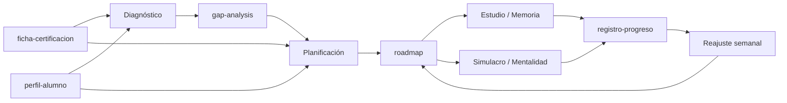

# Estudia tu certificación con IA

Un sistema abierto para preparar **cualquier certificación de ciberseguridad** con IA: diagnóstico inicial, plan adaptado a tu tiempo real, estudio guiado y simulacros con análisis de errores.

Nació del vídeo de Kasiu Tech **"Así usé la IA para aprobar el CISSP"**, pero no está atado al CISSP. Cambias una ficha y sirve para Security+, CySA+, AZ-500, CCSP o la que tengas delante.

> La IA no estudia por ti. Te quita horas mal aprovechadas. Las buenas las sigues poniendo tú.

---

## Qué hay en este repositorio

```
├── proyecto/
│   ├── instrucciones-proyecto.md            ← instrucciones para el proyecto (con skills)
│   └── instrucciones-proyecto-sin-skills.md ← versión para el plan gratuito
├── plantillas/                              ← los documentos que conectan todas las piezas
│   ├── ficha-certificacion.md
│   ├── perfil-alumno.md
│   ├── gap-analysis.md
│   ├── roadmap.md
│   └── registro-progreso.md
├── skills/                                  ← una skill por cada modo
│   ├── cert-diagnostico/
│   ├── cert-planificacion/
│   ├── cert-reajuste/
│   ├── cert-estudio/
│   ├── cert-memoria/
│   ├── cert-simulacro/
│   ├── cert-mentalidad/
│   └── cert-registro/
├── ejemplos/
│   └── cissp/ficha-certificacion.md         ← ficha rellena de ejemplo
└── scripts/
    └── empaquetar-skills.sh                 ← genera los .zip para subir las skills
```

---

## Cómo encaja todo

Todas las skills leen y escriben los mismos documentos. Por eso cada pieza sabe lo que han hecho las demás, aunque abras un chat nuevo cada día.



| Documento | Quién lo crea | Quién lo usa |
|---|---|---|
| `ficha-certificacion` | Tú (o `cert-diagnostico` a partir del temario oficial) | Todas las skills |
| `perfil-alumno` | Tú | Planificación, estudio, memoria |
| `gap-analysis` | `cert-diagnostico` | Planificación, estudio, simulacro |
| `roadmap` | `cert-planificacion` y `cert-reajuste` | Estudio, simulacro, reajuste |
| `registro-progreso` | `cert-registro` (al cerrar cada sesión) | Reajuste |

---

## Los modos

| Modo | Skill | Para qué |
|---|---|---|
| Diagnóstico | `cert-diagnostico` | Test inicial con tu nivel de seguridad en cada respuesta. Saca el gap analysis. |
| Planificación | `cert-planificacion` | Roadmap semana a semana: peso del dominio × tu brecha × tus horas reales. |
| Reajuste semanal | `cert-reajuste` | Cada semana adapta el plan con lo que de verdad ha pasado. |
| Estudio | `cert-estudio` | Conceptos en tres niveles, revisión de apuntes y resumen de capítulo. |
| Memoria | `cert-memoria` | Mnemotecnias y analogías sacadas de tu mundo. |
| Práctica de examen | `cert-simulacro` | Simulacros con corrección razonada y clasificación de errores. |
| Mentalidad del examen | `cert-mentalidad` | Preguntas donde varias respuestas valen y hay que elegir la más correcta. |
| Registro | `cert-registro` | Cierra cada sesión con un bloque listo para el registro de progreso. |

---

## Puesta en marcha

Las instrucciones están pensadas para Claude (proyectos + skills). La idea funciona igual en otras herramientas con proyectos o asistentes personalizados.

### 1. Prepara tus documentos

1. Descarga el temario oficial de tu certificación. Es el **exam outline**, el documento del propio certificador con dominios, subtemas y pesos.
2. Copia `plantillas/ficha-certificacion.md` y rellénala con ese temario. Si te da pereza, en el paso 4 la skill de diagnóstico te ayuda a sacarla del PDF oficial.
3. Copia `plantillas/perfil-alumno.md` y rellénala con **tu tiempo real**, no con el que te gustaría tener.
4. Copia `plantillas/registro-progreso.md` tal cual. Empieza vacío.

### 2. Crea el proyecto

1. En Claude, ve a **Proyectos → Crear proyecto**. Ponle el nombre de tu certificación.
2. En las instrucciones del proyecto, pega el contenido de `proyecto/instrucciones-proyecto.md`. Si estás en el plan gratuito, usa `proyecto/instrucciones-proyecto-sin-skills.md`.
3. Sube a los documentos del proyecto el temario oficial, tu ficha, tu perfil y el registro.

### 3. Instala las skills (planes de pago)

```bash
./scripts/empaquetar-skills.sh
```

El script deja un `.zip` por skill en `dist/`. Súbelos uno a uno desde la sección de skills de la configuración de Claude. Las skills personalizadas necesitan un plan de pago y la ejecución de código activada. La ruta de menús cambia a menudo; si no la encuentras, busca "skills" en el centro de ayuda de Claude.

### 4. Arranca

Abre un chat dentro del proyecto y escribe:

> Quiero empezar con el diagnóstico.

A partir de ahí, cada skill te dice cuál es el siguiente paso.

---

## Tu semana con el sistema

1. **Cada día de estudio:** abre un chat en el proyecto y pide "¿qué toca hoy?". Estudia en modo estudio o memoria. Cierra con el bloque de registro y pégalo en `registro-progreso.md`.
2. **Cuando el roadmap lo marque:** haz un simulacro y registra el resultado.
3. **Cada domingo:** pide el reajuste semanal y sustituye el roadmap del proyecto por la versión nueva.

> Lo que no está en los documentos del proyecto, un chat nuevo no lo sabe. Mantén el registro al día y el sistema funciona solo.

---

## Lo que esto NO hace

- **No sustituye al material oficial.** La IA se equivoca, a veces con mucha seguridad. La fuente de verdad es siempre el temario y el material oficial del certificador.
- **No reproduce preguntas reales del examen.** Casi todos los certificadores te hacen firmar un acuerdo de confidencialidad. Usar volcados de examen te puede costar la certificación. Este sistema entrena el razonamiento, no la memoria de unas preguntas.
- **Las preguntas generadas son orientativas.** Combínalas con los tests oficiales de práctica, que son los que te dan el nivel real.
- **No promete aprobar en dos semanas.** Si alguien te lo vende, desconfía.

---

## Adaptarlo a otra certificación

Solo tienes que crear una `ficha-certificacion.md` nueva. Las skills no tienen nada del CISSP metido a fuego: leen dominios, pesos, formato y mentalidad del examen de la ficha.

Si has hecho la ficha de una certificación que no está en `ejemplos/`, mándala con un pull request. Mira [CONTRIBUTING.md](CONTRIBUTING.md).

---

## Sobre Kasiu Tech

Kasiu Tech es un canal de YouTube en español sobre **carreras en ciberseguridad defensiva**: SOC, Blue Team y Cloud Security. Es para gente técnica que quiere entrar en el sector o dar el salto desde otra rama de IT, y que a veces tiene miedo de que sea demasiado tarde. No lo es.

Lo lleva Kasiu, con más de 15 años en tecnología y hoy al frente de un equipo de ingeniería de ciberseguridad. Sin humo y sin vender motos.

- 📺 **YouTube:** [youtube.com/@kasiu_tech](https://www.youtube.com/@kasiu_tech)
- 🎬 **Vídeo de este repositorio:** [Así usé la IA para aprobar el CISSP](ENLACE_AL_VIDEO)
- 🧭 **Programa de Orientación y Carrera en Ciberdefensa:** [más información](ENLACE_AL_PROGRAMA)
- 💼 **LinkedIn:** [Kasiu](ENLACE_A_LINKEDIN)

Si esto te ayuda, una estrella en el repo y un comentario en el vídeo diciendo qué certificación estás preparando me sirven para saber qué preparar después.

---

## Licencia

[MIT](LICENSE). Úsalo, adáptalo y compártelo. Si lo publicas, se agradece que menciones el origen.
