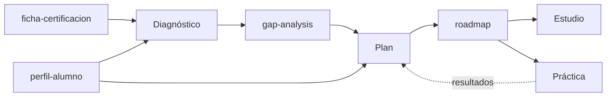

# Estudia tu certificación con IA

Un sistema abierto para preparar **cualquier certificación de ciberseguridad** con IA: diagnóstico inicial, plan adaptado a tu tiempo real, estudio guiado y simulacros con análisis de errores.

Nació del vídeo de Kasiu Tech **"Así usé la IA para aprobar el CISSP"**, pero no está atado al CISSP. Rellenas una ficha y sirve para Security+, CySA+, AZ-500, CCSP o la que tengas delante.

> La IA no estudia por ti. Te quita horas mal aprovechadas. Las buenas las sigues poniendo tú.

---

## Qué hay en este repositorio

```
├── proyecto/
│   ├── instrucciones-proyecto.md             ← con skills (planes de pago)
│   └── instrucciones-proyecto-sin-skills.md  ← plan gratuito
├── plantillas/                               ← lo único que rellenas tú
│   ├── ficha-certificacion.md
│   └── perfil-alumno.md
├── skills/                                   ← una skill por capacidad
│   ├── cert-diagnostico/
│   ├── cert-planificacion/
│   ├── cert-estudio/
│   └── cert-practica/
└── ejemplos/
    └── cissp/ficha-certificacion.md          ← ficha rellena de ejemplo
```

---

## Las cuatro capacidades

| Fase | Skill | Qué hace | Qué genera |
|---|---|---|---|
| 1. Diagnóstico | `cert-diagnostico` | Test inicial marcando lo seguro que estás en cada respuesta | `gap-analysis` |
| 2. Plan | `cert-planificacion` | Roadmap semana a semana con tu tiempo real. Lo reajusta cuando se lo pides y te dice qué toca hoy | `roadmap` |
| 3. Estudio | `cert-estudio` | Conceptos en tres niveles, revisión de apuntes, resúmenes, mnemotecnias y analogías | — |
| 4. Práctica | `cert-practica` | Simulacros con corrección razonada y entrenamiento de la mentalidad del examen | — |

## Cómo encaja todo



Tú rellenas dos documentos. Las skills generan otros dos, que guardas en el proyecto. Con esos cuatro, cualquier chat nuevo sabe dónde estás.

---

## Puesta en marcha

Pensado para Claude (proyectos + skills). La idea funciona igual en herramientas con proyectos o asistentes personalizados.

### 1. Rellena tus dos documentos

1. Descarga el **temario oficial** (exam outline) de tu certificación desde la web del certificador.
2. Rellena `plantillas/ficha-certificacion.md` con ese temario. Para el CISSP tienes un ejemplo en `ejemplos/cissp/`.
3. Rellena `plantillas/perfil-alumno.md` con **tu tiempo real**, no con el que te gustaría tener.

### 2. Crea el proyecto

1. En Claude, crea un proyecto con el nombre de tu certificación.
2. Pega en las instrucciones el contenido de `proyecto/instrucciones-proyecto.md` (o la versión sin skills si estás en el plan gratuito).
3. Sube a los documentos del proyecto el temario oficial, tu ficha y tu perfil.

### 3. Añade las skills (planes de pago)

1. Descarga el repositorio (botón **Code → Download ZIP**) y descomprímelo.
2. Dentro de `skills/` hay cuatro carpetas. Comprime cada una en su propio `.zip` (en Windows: clic derecho → Comprimir en archivo ZIP). Cada `.zip` debe contener la carpeta con su `SKILL.md` dentro.
3. Súbelos uno a uno desde la sección de skills de la configuración de Claude.

Las skills personalizadas necesitan un plan de pago y la ejecución de código activada. Los menús cambian a menudo; si no los encuentras, busca "skills" en el centro de ayuda de Claude.

### 4. Arranca

Abre un chat en el proyecto y escribe:

> Quiero empezar con el diagnóstico.

---

## Tu semana con el sistema

1. **Al empezar:** diagnóstico → guarda el `gap-analysis` → pide el plan → guarda el `roadmap`.
2. **Cada día:** pregunta "¿qué toca hoy?" y estudia o practica.
3. **Cada semana:** pide "reajusta el plan". Te hará unas preguntas rápidas sobre cómo ha ido. Sustituye el `roadmap` del proyecto por la versión nueva.

> Lo que no está en los documentos del proyecto, un chat nuevo no lo sabe. Guarda el gap analysis y el roadmap y todo lo demás funciona solo.

---

## Lo que esto NO hace

- **No sustituye al material oficial.** La IA se equivoca, a veces con mucha seguridad. La fuente de verdad es el temario y el material del certificador.
- **No reproduce preguntas reales del examen.** Casi todos los certificadores te hacen firmar un acuerdo de confidencialidad. Usar volcados te puede costar la certificación. Esto entrena el razonamiento, no la memoria de unas preguntas.
- **Las preguntas generadas son orientativas.** Combínalas con los tests oficiales de práctica.
- **No promete aprobar en dos semanas.** Si alguien te lo vende, desconfía.

---

## Adaptarlo a otra certificación

Solo cambia la ficha. Las skills no llevan nada del CISSP dentro: leen dominios, pesos, formato y mentalidad del examen de la ficha.

¿Has hecho la ficha de otra certificación? Compártela con un pull request. Mira [CONTRIBUTING.md](CONTRIBUTING.md).

---

## Sobre Kasiu Tech

Kasiu Tech es un canal de YouTube en español sobre **carreras en ciberseguridad defensiva**: SOC, Blue Team y Cloud Security. Es para gente técnica que quiere entrar en el sector o dar el salto desde otra rama de IT, y que a veces tiene miedo de que sea demasiado tarde. No lo es.

Lo lleva Kasiu, con más de 15 años en tecnología y hoy al frente de un equipo de ingeniería de ciberseguridad. Sin humo y sin vender motos.

- 📺 **YouTube:** [youtube.com/@kasiu_tech](https://www.youtube.com/@kasiu_tech)
- 🎬 **Vídeo de este repositorio:** [Así usé la IA para aprobar el CISSP](ENLACE_AL_VIDEO)
- 🧭 **Programa de Orientación y Carrera en Ciberdefensa:** [más información](ENLACE_AL_PROGRAMA)
- 💼 **LinkedIn:** [Kasiu](ENLACE_A_LINKEDIN)

Si esto te ayuda, deja una estrella en el repo y un comentario en el vídeo diciendo qué certificación preparas. Así sé qué preparar después.

---

## Licencia

[MIT](LICENSE). Úsalo, adáptalo y compártelo. Si lo publicas, se agradece que menciones el origen.
